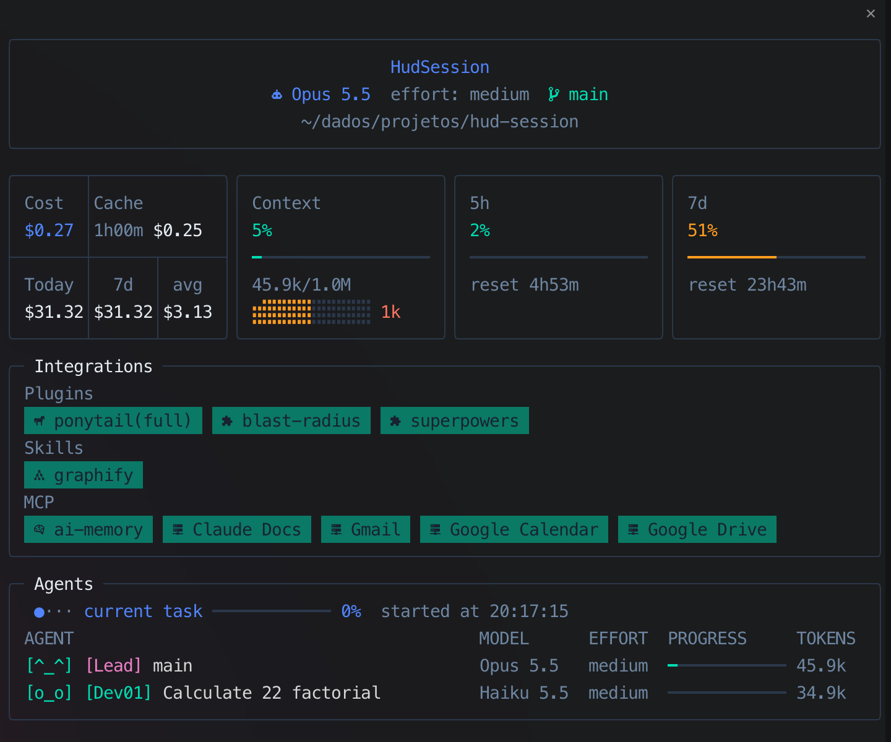

# HudSession

A side pane for [Claude Code](https://claude.com/claude-code) that keeps the state of your session in view: the model and what it costs, how full the context is, your usage limits, the plugins, skills and MCP servers you have, where you are, and what your agents are doing.



## What each section shows

### Header

`HudSession`, then the main loop's model (`claude-opus-5-5` reads `Opus 5.5`), its effort (the last request's, else the `/config` effort, else `effortLevel` from `settings.json`, else `default`), the git branch, and the session's working directory (`~` in place of your home folder).

### KPI cards

Small framed cards, side by side; they wrap by the pane width (about 18 cells each, stretched to fill the row).

| card | what it is |
|---|---|
| Cost | the top is split in two by a `│`. Left, `Cost`: the session's cost so far (`-` when Claude Code reports none). Right, `Cache`: the prompt-cache spend of the session (every agent, summed per API response: cache reads at the model's read price plus cache writes at 2x its input price, the 1-hour-TTL write rate) and the time left on the cache, e.g. `34m $0.12`; `cold` once it expired, `-` before any priced response. The prices are a built-in table by model id prefix (Fable/Mythos 5.1 and 5, Opus 5.5, 5 and 4, Sonnet 5.5, 5 and 4, Haiku 5.5 and 4); a model not in it adds nothing. The 1-hour TTL is an assumption: Claude Code does not expose its cache TTL to mods, and only main-loop responses restart the countdown. Below it, three fixed columns split by `│` (`Today`, `7d`, `avg`, centered): cost summed since local midnight, summed over the last 7 days, and the mean cost per session over those 7 days (the live session counts even before the ledger catches up); `-` when there is none. Values are left-aligned: `>= 1000` shows 0 decimals (`$1235`), `>= 100` shows 1 (`$123.5`), otherwise 2 (`$1.23`); fewer decimals if the column is too narrow. The pane keeps its own ledger in `$.store` (updated at each `session.measure`), limited to the last 7 days and at most 500 sessions |
| Context | how full the context window is: percent, tokens used / window size (updated after each API response during a turn, replaced by the measured value at turn end) then a sparkline of the context size at the end of the last 12 turns: always 12 cells, one turn per cell (Braille bars, scaled to the largest), filling left to right; unused slots stay as gray full bars. After the cells comes the change since the previous turn, no arrow, no sign and no decimals (`3k`, `800`), red when the context grew and green when it shrank. `0%` before the first turn |
| 5h, 7d | your usage limits: percent used and the time until each resets. Always drawn: `0%` until Claude Code reports them, `100%` once a limit is reached. Any other limit kind reported gets its own card after these |

Percent colors: green below 25%, blue below 50%, yellow below 75%, red above.

### Integrations

One box with three groups of chips. Green when on, red when off; empty groups read `Empty`.

- **Plugins**: the plugins enabled in `~/.claude/settings.json` (`enabledPlugins`). `ponytail` also shows its level (read from `~/.claude/.ponytail-active`) and is red while the level is `off`. HudSession leaves itself out.
- **Skills**: `graphify`, green when its command is available in the session.
- **MCP**: the MCP servers whose tools the session has, read from the tool list (`mcp__<server>__<tool>`). `ai-memory` turns yellow and reads `ai-memory (no hooks)` when its capture hooks are missing from `~/.claude/settings.json`.

### Agents

A table.

- **The task row**: the current task's title (`current task` when it has none), a progress bar and percent, the phase, and `started at` / `finished at` in local time (`HH:MM:SS`).
  - With a flow reported through the `progress` tool, the bar is tasks done over tasks planned, and the times are the flow's.
  - With no flow and no subagents, the row is `current task` for the main loop's turn: `started at` is the turn start, `finished at` its end, the bar 0% while it runs and 100% when done.
  - Without one, the bar is agents finished over agents spawned, `started at` is the first agent's spawn and `finished at` appears once every agent is done.
- **One row per agent** under an `AGENT MODEL EFFORT PROGRESS TOKENS` header, the running ones first: a small blinking robot `[o_o]` in the agent's color (a static `[^_^]` once done), its role tag (`[Dev01]`, `[Rev01]`, `[QA01]`, `[Plan01]`, `[Exp01]`, numbered at spawn and never renumbered, in the agent's color), its name, model, effort, a bar of its own steps (or of its context against the window when it reports none), and its context size in tokens.
- The first row is always the main agent (`[Lead] turn 3 · working 0:12` while its turn runs, `turn N` counting typed prompts only (injected `<...>` turns do not count; no `turn` text before the first prompt), ticking every second; `[Lead] done in 0:41` once it is done; `[Lead] idle` before the first prompt; `H:MM:SS` from one hour), with or without subagents: its bar is the context fill, its robot turns into `[^_^]` when its turn is done. The Agents box is never empty.
- The task row starts with its own animated figure pushing a block (a static `\o/` once the task is finished).

The subagents list is cleared at each new prompt: only agents delegated during the current request show. A finished flow is cleared too (an open one stays), so the task row falls back to the main turn's times.

## Where it is drawn

Only in the side pane. It opens with the session; `/hud-session` reopens it. The pane scrolls, so every agent is listed. Nothing is drawn above the prompt.

## Tools it adds

| tool | for | what it does |
|---|---|---|
| `mcp__hud-session__progress` | the main session | reports the task flow: `title`, `total`, `done`, `phase` (`plan`, `design`, `delegate`, `review`, `close`), `finished`. A new title starts a new flow. Calls from subagents are ignored |
| `mcp__hud-session__step` | subagents | reports an agent's own steps (`done`, `total`, `note`) for its bar. Spawned agents are not asked to call it (`ASK_STEPS = false`, to save tokens), so their bar shows token use unless an agent calls it on its own |

## Install

Requirements: Claude Code with mods (plugins with a hooks module), and a [Nerd Font](https://www.nerdfonts.com/) in the terminal for the icons.

```bash
git clone https://github.com/leandrocavalheiro/hud-session ~/.claude/mods/hud-session
```

Then load it, either for one session:

```bash
claude --plugin-dir ~/.claude/mods/hud-session
```

or for every session, in `~/.claude/settings.json`:

```json
{ "env": { "CLAUDE_CODE_PLUGIN_DIRS": "~/.claude/mods/hud-session" } }
```

## Develop

```bash
claude plugin validate .   # what the engine would refuse
claude plugin test .       # hooks/register.test.tsx
```

The engine writes the API types into `.claude-plugin/types/` when it loads the mod (ignored by git); `tsconfig.json` extends them.

| file | what it is |
|---|---|
| `.claude-plugin/plugin.json` | the manifest |
| `hooks/hooks.json` | names the hooks module |
| `hooks/register.tsx` | the hooks: state, tools, the pane |
| `hooks/register.test.tsx` | the tests |
| `types/index.d.ts` | the state contract |

## Privacy

Everything is read locally and drawn in your terminal: `~/.claude/settings.json`, `~/.claude/.ponytail-active` and `git branch`. Nothing is sent anywhere.
